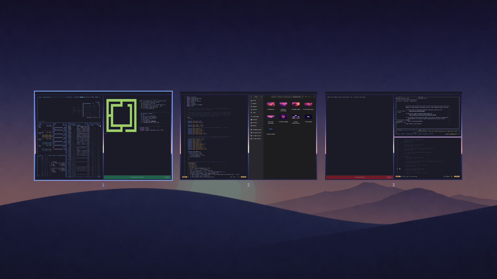

# Overview for Omarchy

A macOS Mission Control-style overview of your workspaces for [Omarchy](https://omarchy.org), built as an Omarchy shell plugin.

Swipe up with three fingers and your desktop shrinks into its own card while the other workspaces slide in around it, **following your fingers 1:1**. Let go and it settles like a spring, carrying the speed of your swipe. Swipe down to zoom back in.



- The zoom starts from a still of the real screen (bar, borders and wallpaper), so the first frame matches the desktop exactly, then hands over to live thumbnails
- Live window thumbnails, placed where each window sits on screen
- Click a workspace to go there, or a window to focus it; the chosen card zooms back to fill the screen
- Keyboard: arrows or `hjkl` to select, `Enter` to go, `1`–`9` to jump to a workspace, `Esc` to close
- Follows the Omarchy theme: accent color, menu font and corner rounding (`omarchy hyprland corners`)
- Respects `omarchy toggle animations`
- Thumbnails only stream while the overview is open and still; nothing is captured while it is closed

## Requirements

- Omarchy with the Quickshell-based `omarchy-shell`
- Hyprland 0.56 or newer with a Lua config (`~/.config/hypr/*.lua`), for gesture callbacks
- A touchpad for the gesture (the keyboard/command toggle works without one)

No other dependencies.

## Install

```bash
omarchy plugin add https://github.com/matheustimbo/omarchy-overview.git --enable
omarchy restart shell
```

Plugins can't register gestures or keybindings, so add them yourself.

**Gesture** — in `~/.config/hypr/input.lua`:

```lua
-- 3-finger vertical swipe drives the overview live: up opens, down closes.
hl.gesture({
  fingers = 3,
  direction = "vertical",
  action = {
    start = function() hl.dispatch(hl.dsp.event("matheustimbo.overview:start")) end,
    update = function(e) hl.dispatch(hl.dsp.event("matheustimbo.overview:update:" .. ((e.delta and e.delta.y) or 0))) end,
    ["end"] = function(e) hl.dispatch(hl.dsp.event("matheustimbo.overview:end:" .. ((e and e.cancelled) and "1" or "0"))) end,
  },
})
```

Omarchy's three-finger horizontal swipe already switches workspaces, so vertical swipes are free.

**Layer rule** — in `~/.config/hypr/looknfeel.lua`, so Hyprland doesn't animate the overlay on top of the plugin's own motion:

```lua
hl.layer_rule({ match = { namespace = "^(matheustimbo-overview)$" }, no_anim = true, animation = "none" })
```

**Optional keybinding** — in `~/.config/hypr/bindings.lua`:

```lua
o.bind("SUPER + GRAVE", "Overview", "omarchy-shell shell toggle matheustimbo.overview")
```

## Tuning

At the top of `Overview.qml`:

- `gestureDistance` (default `260`): touchpad distance for a full open or close
- `openMs` / `closeMs`: duration of keyboard/command-driven animations
- `switchHold` interval (default `430` ms): how long the overlay stays up after switching workspace, so Hyprland's workspace slide finishes underneath it. Match it to your `workspaces` animation speed.

## Notes

- Hyprland 0.56.2 doesn't call a Lua gesture's `end` callback, so the plugin treats a 45 ms pause in gesture updates as the fingers lifting.
- The overlay surface stays mapped (transparent, with an empty input region and no keyboard focus) while closed, so a swipe can show it on the next frame. It only takes input once the overview is open and the swipe is over.

## Update

```bash
omarchy plugin update matheustimbo.overview
omarchy restart shell
```

## Remove

```bash
omarchy plugin remove matheustimbo.overview
```

Then delete the gesture, layer rule and keybinding you added above, and run `hyprctl reload`.

## License

[MIT](LICENSE)
